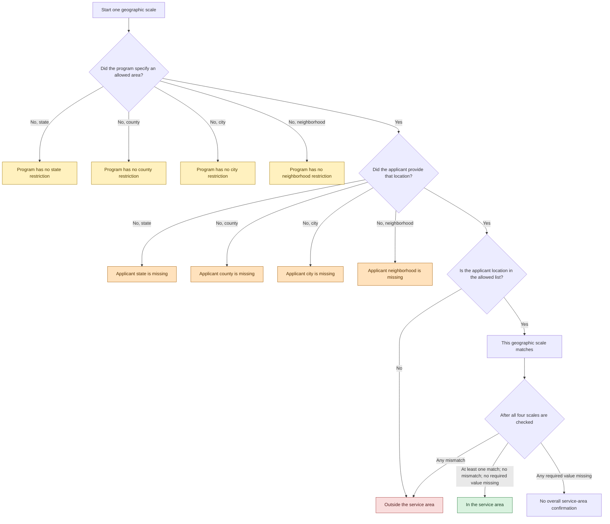
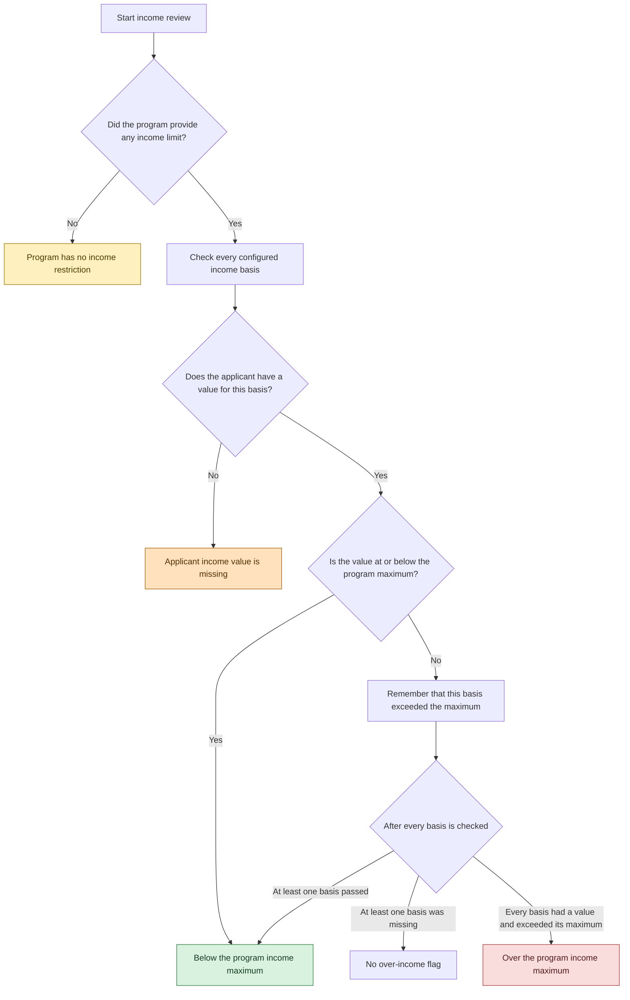
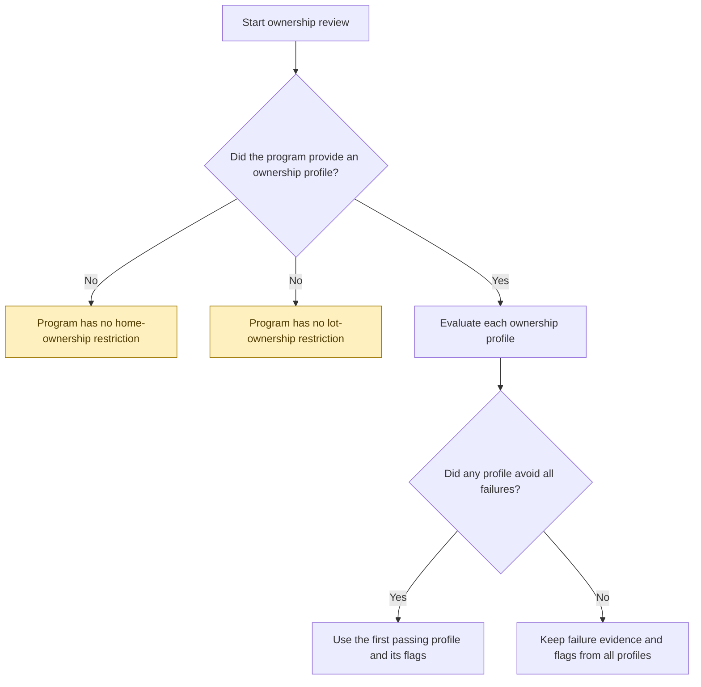
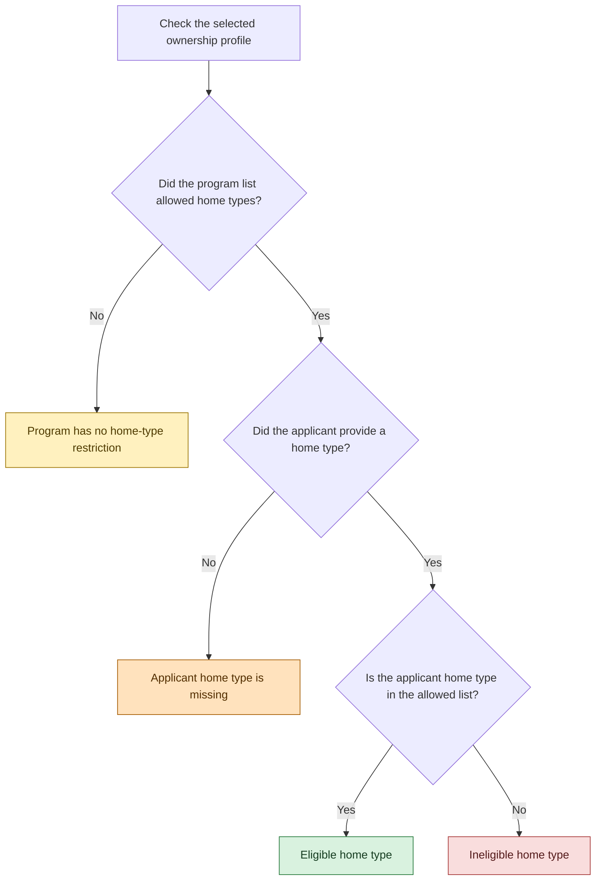
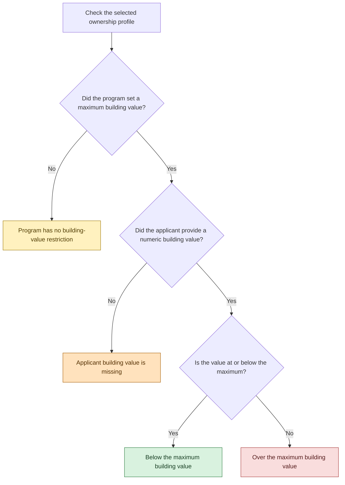
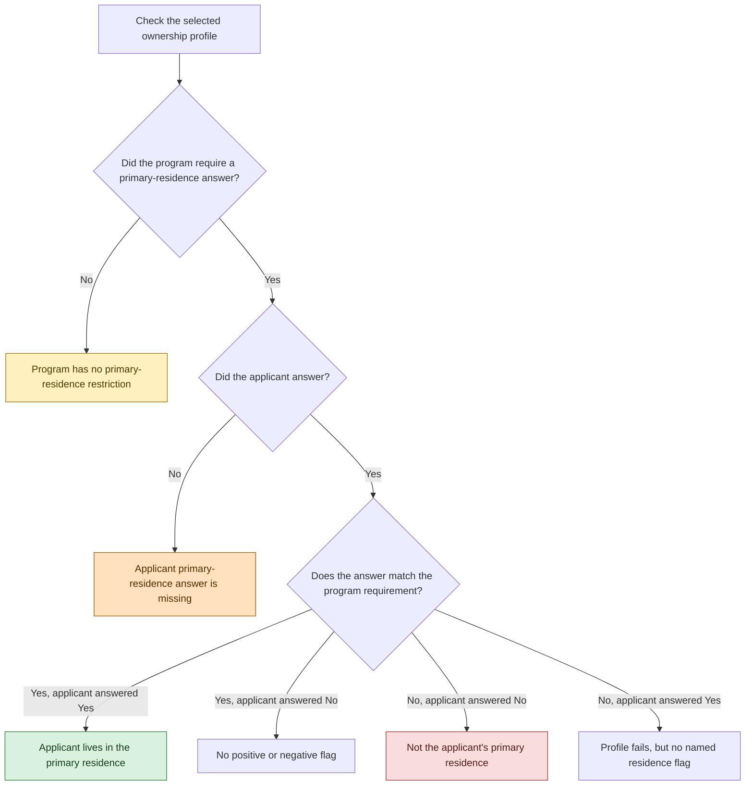
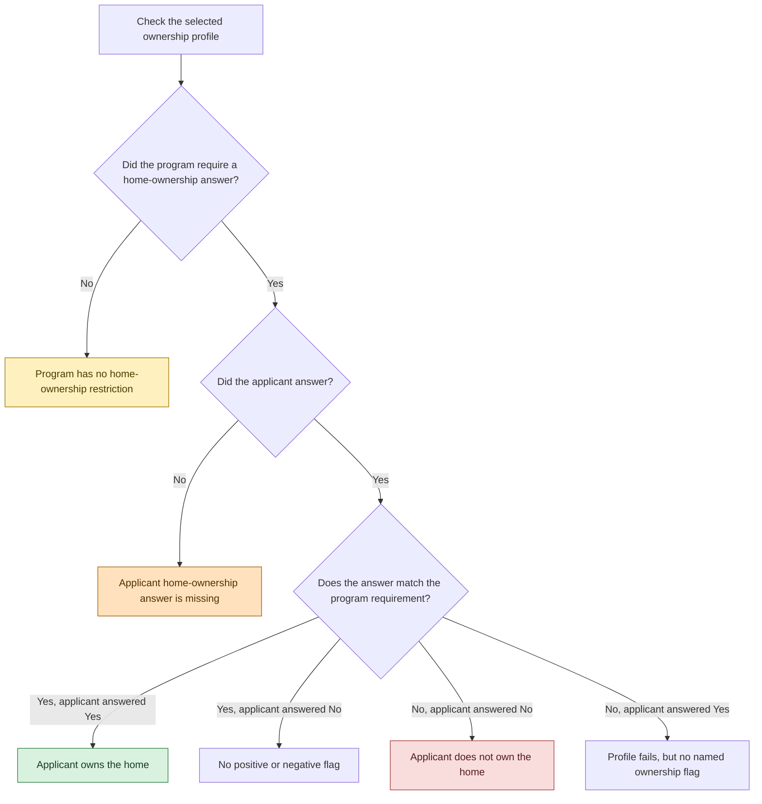
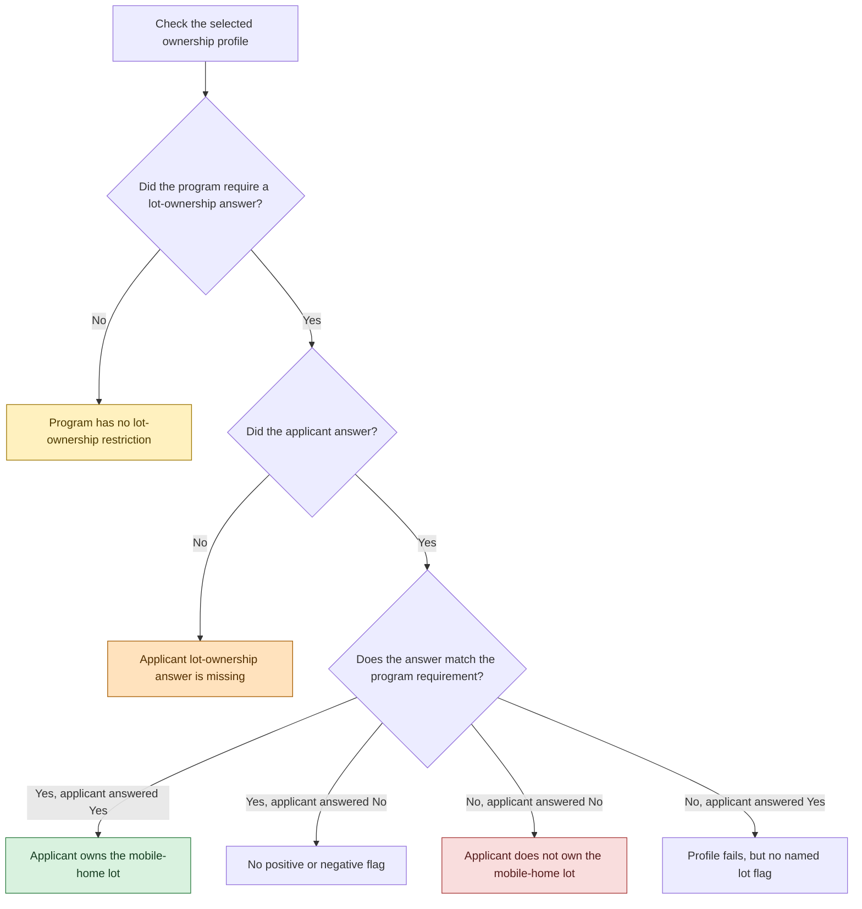
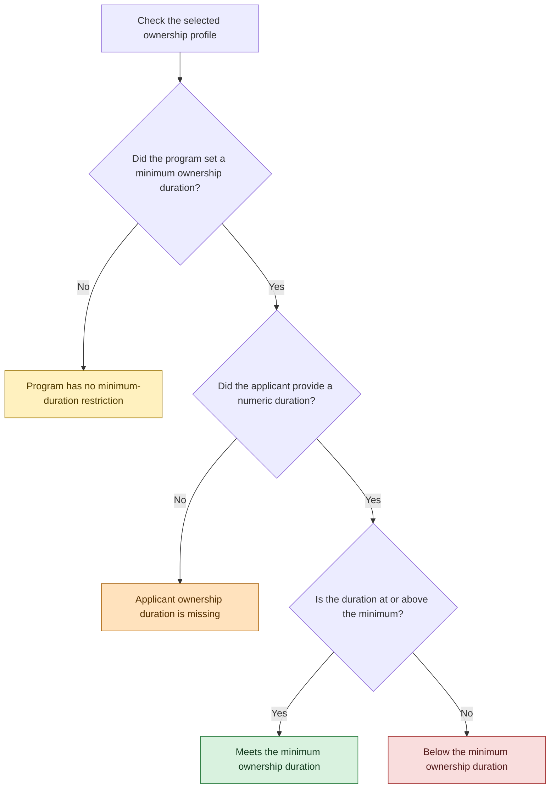
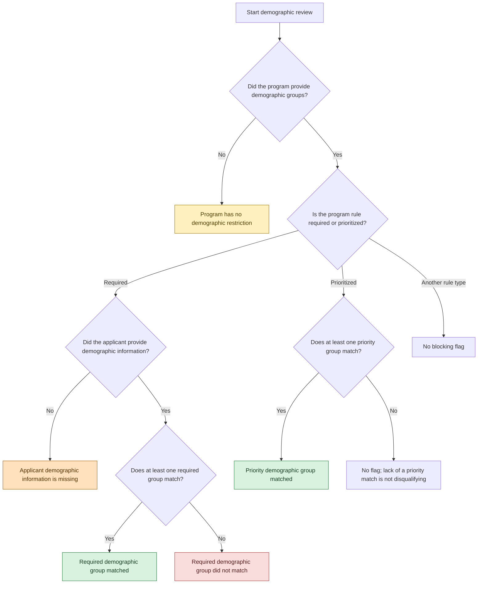

# Eligibility Flag Decision Diagrams

Every colored end node below represents a flag attached to a Report Program record.
Labels describe what staff see; Airtable field names and record IDs are intentionally omitted.

## Legend

- Green: a favorable condition was confirmed.
- Red: a configured restriction was not met.
- Yellow: the program did not provide a restriction.
- Orange: the applicant did not provide information needed for the comparison.

## Service Area

The same scale check runs independently for state, county, city, and neighborhood.

North Carolina, N. Carolina, and NC are treated as the same state. The word
“County” and the prefixes “City of” and “Town of” are ignored during comparison.

## Income

Programs may supply more than one income basis. Any passing basis is sufficient.

## Ownership Profiles

A program may define alternative ownership profiles. The first profile with no
failed restriction is used. When none passes, failure evidence from every profile
is retained.

The former “Program has no ownership restrictions” flag is retired and is not
produced. The two more specific omission flags above are produced instead.

### Home Type

### Building Value

### Primary Residence

### Home Ownership

### Mobile-Home Lot Ownership

### Ownership Duration

## Demographics

## Important Interpretation Notes

1. A yellow flag describes missing program criteria. It does not mean the applicant failed.
2. An orange flag describes missing applicant data. It prevents confirmation of the corresponding green flag but is not itself a red failure.
3. A Report Program record can receive several flags from the same decision area.
4. Repeated detections of the same condition are collapsed to one linked flag, while the detailed report retains the supporting evidence.
5. Neighborhood omission and missing-data flags must exist in the FlagList before they can be linked. Until then, they appear only as unconfigured evidence.
