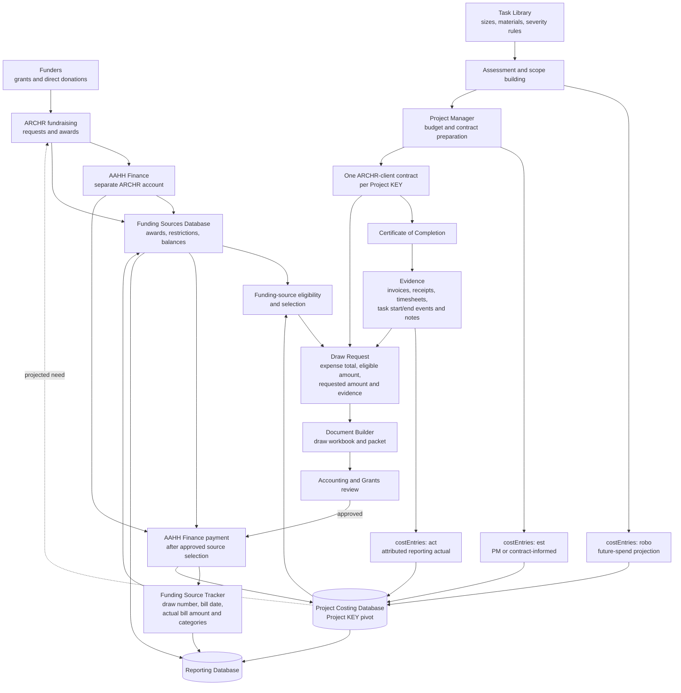
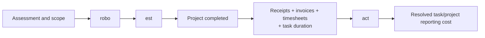

# ARCHR project costing and reimbursement flow

The Project Costing Database is a reporting and automation system. It does not
replace the AAHH Finance accounting ledger. `projectKey` is the pivot used to
join task planning, project evidence, funding selection, document generation,
payment confirmation, and downstream reporting.

## Cost resolution

Cost entries are append-only reporting observations. For the same task, the
resolver normally prefers `act` over `est`, and `est` over `robo`; it does not
delete the earlier entries. An attributed `act` entry should identify its
calculation method and the evidence or task events used as its basis.

## Sparse input versus resolved snapshot

- `schemas/costing-input.schema.json` describes partial, idempotent writes to
  the automation engine.
- `schemas/costing-snapshot.schema.json` describes the fully resolved
  Project-KEY-centered reporting object.
- Missing properties in an input event mean “unchanged.” Array members are
  upserted by their stable IDs. Removal or voiding must be explicit.
- Funding-source balances and bank activity remain authoritative in their
  respective systems. The costing snapshot contains references and reporting
  values needed to prepare and explain reimbursement.

