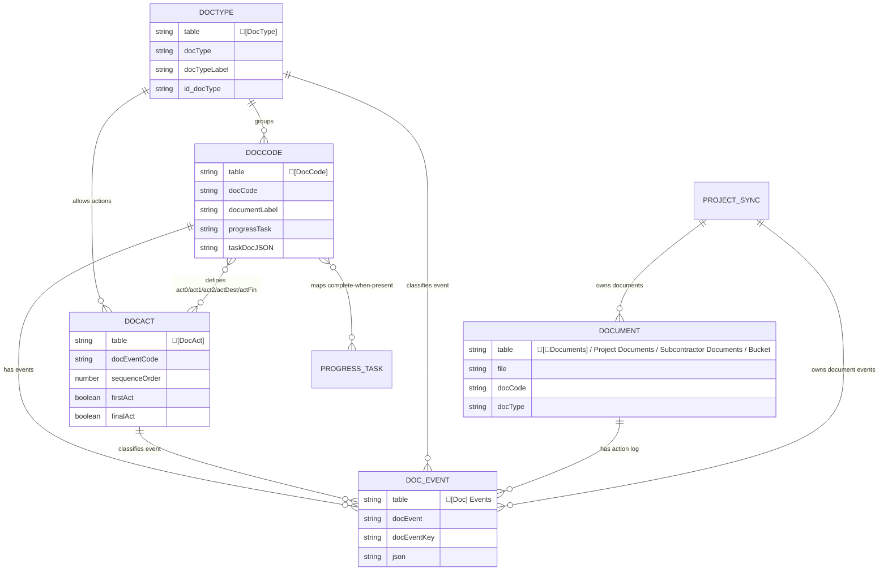
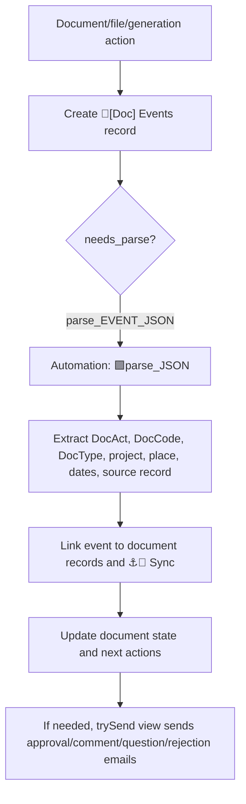
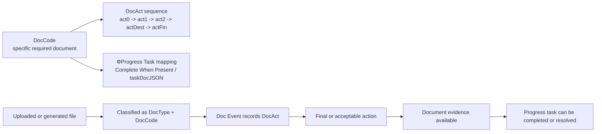

# Document Classification: DocType, DocCode, and DocAct

Source: `C:\Users\bwyatt\Downloads\🔷Tables-docs.csv`, exported from `[D] ARCHR Project Documents`.

This document explains how the document taxonomy works and how it connects to progress tracking. It pairs with [progress-tracker.md](progress-tracker.md), [document-search-token-matching.md](document-search-token-matching.md), and [docupilot-generation.md](docupilot-generation.md).

## Summary

The document system separates document identity from document workflow:

| Concept | Table | Meaning |
|---|---|---|
| Document category | `🔷[DocType]` | Broad class of document, such as a folder/filter category. |
| Specific document requirement | `🔷[DocCode]` | The canonical document item that can satisfy a requirement, display as a card/action, and map to progress tasks. |
| Document action/status | `🔷[DocAct]` | The action state for a document, such as first action, intermediate action, destination action, or final action. |
| Event instance | `🔷[Doc] Events` | A dated/logged action against a document, project, file, subcontractor document, or generated document. |
| File/document record | `🔷[📎Documents]`, `🔷Project Documents`, `🔷Subcontractor Documents`, `🔷🪣Bucket` | The uploaded/generated file records that get classified with DocType, DocCode, and DocAct. |

`DocType` says what kind of thing a file is. `DocCode` says which exact required document or generated artifact it is. `DocAct` says what happened or what still needs to happen to that document.

## Core Tables

| Table | Table ID | Main role |
|---|---:|---|
| `🔷[DocType]` | `tbluw1LAOvDdVx3K8` | Category registry. Links to DocCodes, DocActs, Docupilot templates, folder structure, search tokens, documents, and partner programs. |
| `🔷[DocCode]` | `tblXLYYDEbby2D9nb` | Requirement/artifact registry. Links to DocType, DocAct stages, documents, Docupilot templates, search tokens, partner programs, folder structure, and progress metadata. |
| `🔷[DocAct]` | `tbluLywgoy2fLWVqg` | Action registry. Links actions back to DocCodes and DocTypes and defines sequence/order flags. |
| `🔷[Doc] Events` | `tbl1AyB7Bhq4Ni90Y` | Action log. Parses event JSON and links events to DocAct, DocCode, DocType, project, place, files, people, orgs, and subcontractor/project documents. |
| `🔶[🏁🎯>📎 Sync]` | `tblO8Q406icPVLC8P` | Synced project/progress context inside the documents base. Links document records back to progress/project records. |

## Relationship Model

## DocType

`🔷[DocType]` is the broad category layer. Important fields include:

| Field | Role |
|---|---|
| `docType`, `docTypeTXT`, `docTypeLabel`, `docTypeLabel+Icon`, `docTypeIcon` | Human-readable and UI-facing category labels. |
| `docTypeSort` | Sort order for display and filtering. |
| `id(docType)` | Stable DocType identifier. |
| `👁️Softr Folder Label` | UI label for folder-like display in Softr. |
| `[DocCode]` | Specific document requirements inside the type. |
| `[DocAct]` | Actions that apply to this type. |
| `SEARCH_TOKENS`, `DocCode_SEARCH_TOKENS` | Matching vocabulary used to classify files. |
| `[🪄Docupilot Templates]` | Generated document templates associated with this type. |
| `💛Partner Programs` | Program-specific accepted documentation or requirements. |

DocType is useful for UI filtering and coarse classification. It should not be treated as the final requirement state, because a file may be the right category but the wrong required document.

## DocCode

`🔷[DocCode]` is the specific document requirement/artifact layer. Important fields include:

| Field | Role |
|---|---|
| `docCode`, `docCodeTXT`, `id(docCode)` | Canonical code and ID. |
| `Document Label`, `Document Name`, `docCard`, `cardIcon`, `docIcon` | Human-facing display data. |
| `[DocType]` | Parent category. |
| `Parent`, `Child`, `[DocGroup] (from Parent)` | Hierarchy/grouping. |
| `💛Partner Programs`, `Partner Program: Accepted Documentation` | Program-specific requirement context. |
| `SEARCH_TOKENS` | Matching vocabulary for auto-classification. |
| `[🪄Docupilot Templates]`, `inputJSON (from [🪄Docupilot Templates])` | Generation templates and template payload config. |
| `Project Documents`, `Subcontractor Documents`, `[📎Documents]`, `Collection Bucket` | File/document instances that were classified as this DocCode. |
| `(Progress) Phase Tasks`, `(Progress) Phases`, `[⚙️Progress Tasks] Complete When Present`, `⚙️Progress Task`, `⚙️Phase`, `⚙️taskDocJSON` | Progress tracker bridge. |
| `act0`, `act1`, `act2`, `actDest`, `actFin` | Ordered actions attached to this document code. |
| `[DocAct]_KEYS`, `[DocAct]_DONE`, `[DocAct]_FIRST_TODO`, `[DocAct]_SECOND_TODO` | Computed action state and next-action hints. |
| `actionJSON`, `POS Action`, `NEG Action`, `url1`, `url2` | UI/action metadata for document workflow buttons. |

DocCode is where document requirements become progress-relevant. If a DocCode says a `⚙️Progress Task` is complete when present, then a matching file or final DocAct can provide progress evidence.

## DocAct

`🔷[DocAct]` describes what can happen to a document. Important fields include:

| Field | Role |
|---|---|
| `docEventCode` | Code used by document event parsing and event keys. |
| `Sequence Order` | Order of the action within the workflow. |
| `First Act`, `Final Act` | Boundary flags for start/end of a document workflow. |
| `DONE` | Completion label/state for the action. |
| `Destructive Action` | Marks actions that may undo, reject, remove, or replace document state. |
| `iconButtonLabel`, `Tags`, `Name` | UI and grouping metadata. |
| `[DocCode] | act0`, `[DocCode] | act1`, `[DocCode] act2`, `[DocCode] actDest`, `[DocCode] actFin` | The different places a DocAct can sit in a DocCode sequence. |

The DocCode table keeps named links for `act0`, `act1`, `act2`, `actDest`, and `actFin`. That means each DocCode can define a custom workflow while still reusing shared DocAct records.

## Event Flow

`🔷[Doc] Events` is the event log for document actions. It has views `parse_EVENT_JSON`, `trySend`, `_NEW_`, `KEYS`, and `Project Doc Events Sync`. The CSV shows two automations:

- `parse_EVENT_JSON` -> `🟪parse_JSON`
- `trySend` -> `🟪(PRC) Send email on Doc Events Comment / Question / Rejection copy`

The event record stores both raw and parsed state:

- Raw event fields: `JSON`, `JSON Lookup`, `JSON_docEvent`, `JSON_personId`, `JSON_subDocId`
- Parsed fields: `extract_🎯`, `extract_📍`, `extract_dateCreated`, `extract_dateModified`, `extract_docAct`, `extract_docCode`, `extract_docRecordId`, `extract_docType`
- Key fields: `[DocEvent]_KEY`, `docEvent_RECORD_ID`, `id(progressDocEvent)`
- Links: `[DocAct]`, `[DocCode]`, `[DocType]`, `⚓🎯 Sync`, `⚓📍Sync`, `Collection Bucket`, `Project Documents`, `Subcontractor Documents`, `[🪄 Document Creator]`, `Person`, `Org`

## Interaction With Progress Tasks

The progress bridge is visible from both bases:

- In the documents base, `🔶[🏁🎯>📎 Sync]` carries project/progress context and links to `[📎Documents]`.
- In `🔷[DocCode]`, fields such as `(Progress) Phase Tasks`, `(Progress) Phases`, `[⚙️Progress Tasks] Complete When Present`, `⚙️Progress Task`, `⚙️Phase`, and `⚙️taskDocJSON` map a document code to progress tracker tasks.
- In [progress-tracker.md](progress-tracker.md), `🔶[⚙️Progress Tasks]` has document-related fields such as `[DocTypes]`, `Required Documents`, `requiresEvidence`, and DocCode sync links like `📎Act0 [DocCode] Sync`, `📎Act1 [DocCode] Sync`, `📎Act2 [DocCode] Sync`, and `📎ActFin [DocCode] Sync`.
- Progress V2 resolves events into `🔷[☑️Project Task Completion]`. Document classification can provide the evidence that a phase task is complete.

## Practical Rules

1. Use `DocType` for category and UI filtering.
2. Use `DocCode` for the actual requirement, generated template, and progress mapping.
3. Use `DocAct` for document workflow state and next actions.
4. Use `Doc Events` for audit/history, not just current state.
5. Treat `DocCode + DocAct + project/file` as the key combination that explains whether a document satisfies a requirement.
6. Treat `[⚙️Progress Tasks] Complete When Present` as a progress bridge, not as proof by itself. The matching file/event still needs to be linked and classified correctly.

## Open Questions

- Exact allowed DocAct values and which ones are considered positive, negative, final, or destructive.
- Whether `actDest` is a routing/destination action, a review outcome, or a terminal pre-final action in all workflows.
- Which DocCodes are currently authoritative for Progress V2 completion versus legacy status/event completion.
