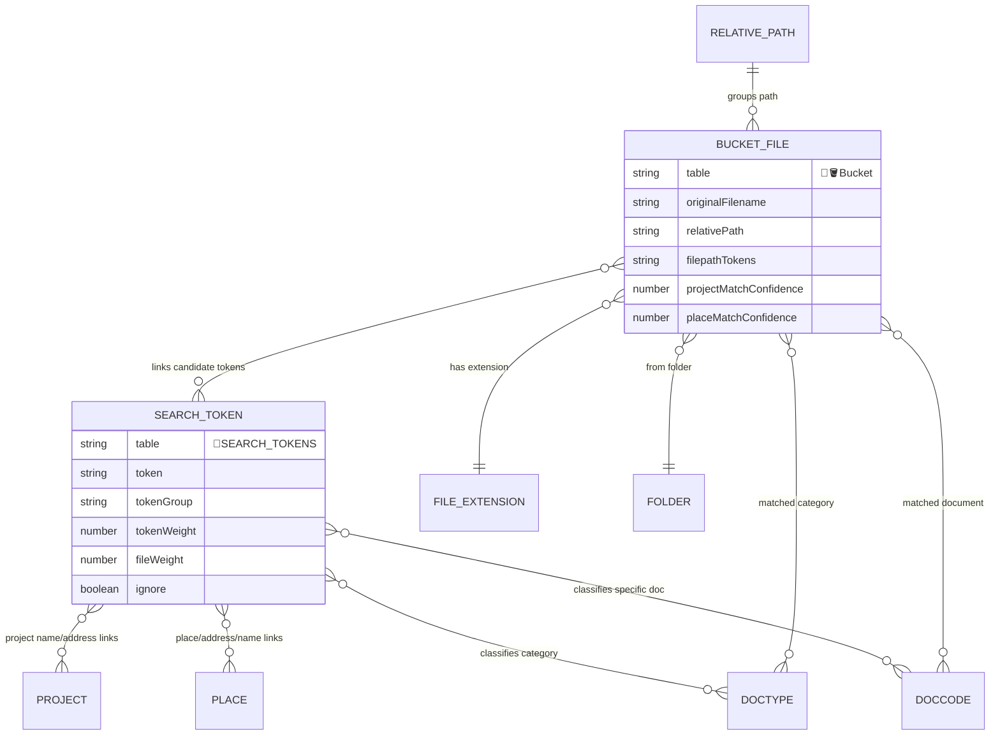
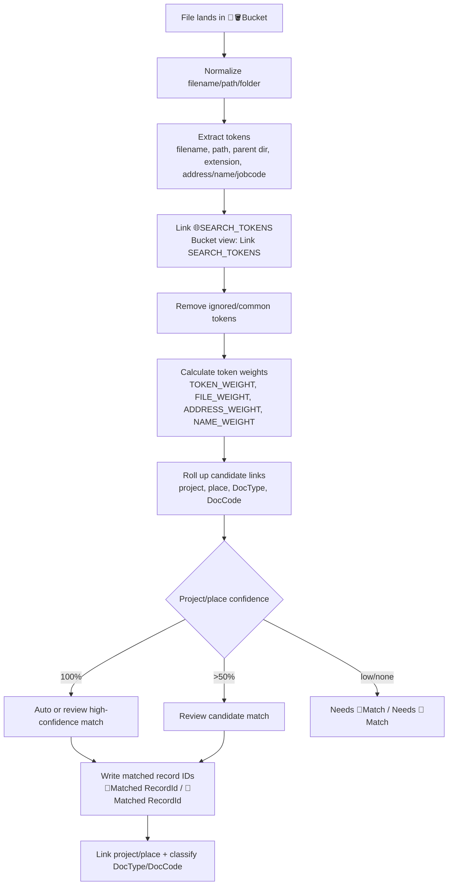
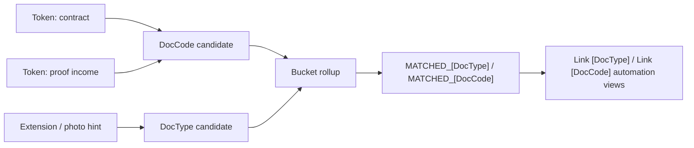

# SEARCH_TOKEN File Matching

Source: `C:\Users\bwyatt\Downloads\🔷Tables-docs.csv`, exported from `[D] ARCHR Project Documents`.

This document explains how uploaded or discovered files are matched to projects, places, DocTypes, and DocCodes using `SEARCH_TOKENS`. It pairs with [document-classification-doc-types.md](document-classification-doc-types.md) and [docupilot-generation.md](docupilot-generation.md).

## Summary

The matching system uses tokens extracted from file paths, filenames, folder names, document labels, addresses, names, orgs, subcontractors, file extensions, and DocCode/DocType metadata. A file in `🔷🪣Bucket` links to matching `🔷SEARCH_TOKENS`; rollups and formulas then produce confidence scores for project and place matching.

The system is intentionally weighted. A token that appears across many files is weaker than a rare token. Address/name/project-specific tokens should carry more confidence than generic terms or common file extensions.

## Core Tables

| Table | Table ID | Main role |
|---|---:|---|
| `🔷🪣Bucket` | `tbl5nbcbvUJ9kiN7t` | File intake/staging table. Holds path, file metadata, attachments, search token links, match confidence fields, and classification links. |
| `🔷SEARCH_TOKENS` | `tblE8f5E7WCKQYSTH` | Token registry. Stores token text, group, links to files/projects/places/DocCodes/DocTypes, ignore state, and weights. |
| `🔷RelativePaths` | `tblIYAfAhRriQzH9w` | Path parsing support. Holds parent/grandparent path pieces and search-token rollups from bucket records. |
| `🔷Folders` | `tbldONlLtXLeaxG6K` | Folder registry linked to bucket records. |
| `🔷FILE_EXTENSIONS` | `tblFPT4ssU4rFQB6g` | Extension registry with gallery/photo hints and extension-derived token counts. |
| `🔷BEST_GUESS` | `tbl2MUcUEFT9dBtJo` | Small helper table linked to search tokens for guessed token meaning. |

## Matching Data Model



## Token Sources

`🔷🪣Bucket` exposes several extraction fields:

| Bucket field | Purpose |
|---|---|
| `originalFilename`, `Name`, `relativePath`, `normalizedRelativePath`, `pathMinusFile`, `sourceRoot`, `fromPath` | Source text for tokenization. |
| `🪣FILEPATH_TOKENS_CSV` | Parsed path/filename tokens. |
| `Extract Jobcode`, `Extract Name`, `Extract 📍Address from 📍Name`, `Extract 📍Name from 📍Address` | Direct extraction heuristics. |
| `REGEX_ids(ADDRESS)`, `REGEX_ids(NAME)` | Formula/regex-style candidate extraction. |
| `fileExtension`, `FILE_EXTENSIONS` | Extension classification and photo/document hints. |
| `🌐🌐Parent_Directory SEARCH_TOKENS` | Inherited tokens from parent directory context. |

`🔷SEARCH_TOKENS` stores token type and lineage:

| Search token field | Purpose |
|---|---|
| `token`, `token_length` | Token text and length. |
| `Token Group`, `TOKEN_GROUP` | Token class such as address, name, DocCode, DocType, org, file extension, or ungrouped. |
| `ignore`, `ignored_token`, `includToken` | Manual/include-exclude controls. |
| `isName`, `isFileExtension`, `DSW`, `ORG`, `SUB` | Type-specific flags or labels. |
| `[DocCode]`, `[DocType]`, `💜ORG_LINK`, `🚚SUB_LINK` | Classification/domain links. |
| `⚓🎯 NAME_LINK`, `⚓🎯 ADDRESS_LINK`, `⚓📍NAME_LINK`, `⚓📍ADDRESS_LINK` | Project/place candidate links by name/address. |
| `FILES`, `Count (FILES)`, `id(FILE) Rollup (from FILES)` | The file population using the token. |

## Matching Sequence



The `🔷🪣Bucket` views show the stages:

- `Link SEARCH_TOKENS`
- `Needs 🎯Match`
- `Tried 🎯Match`
- `🎯Match`
- `🎯Match Confidence >50`
- `🎯Match Confidence = 100`
- `Needs 📍Match`
- `Tried 📍Match`
- `📍Match Confidence >50`
- `📍Match Confidence = 100`
- `REVIEW_MATCH`
- `Link [DocType]`
- `Link [DocCode]`
- `[DocType] Linked`
- `[DocCode] Linked`
- `UNLINKED`
- `❗❗skipSearch`

## Weighting Model

The CSV does not expose formulas directly, but the fields describe the model:

| Field | Inferred purpose |
|---|---|
| `TOKEN_WEIGHT` | Overall value of a token for matching. |
| `FILE_WEIGHT` | Downweights tokens that appear in many files. This prevents common words like "invoice", "scan", or "photo" from dominating. |
| `ADDRESS_WEIGHT` | Weight assigned when token points to address links. |
| `NAME_WEIGHT` | Weight assigned when token points to name links. |
| `[DocCode] Weight` | Weight assigned to document code classification. |
| `Count (FILES)` | Population count used to decide whether a token is rare or common. |
| `Count (⚓📍ADDRESS_LINK)`, `Count (⚓📍NAME_LINK)`, `Count ([DocCode])` | Candidate ambiguity counts. |
| `🌐⚖️TOKEN_WEIGHT_ADDRESS_MATCH`, `🌐⚖️TOKEN_WEIGHT_NAME_MATCH`, `🌐⚖️TOKEN_WEIGHT_SUM` | Bucket-level rollups/scores from matched tokens. |
| `MATCH_PERCENT`, `MATCH_REPORT`, `matchJson` | Consolidated matching output. |

The likely scoring idea:

```text
candidate confidence =
  sum(weighted tokens supporting candidate)
  / sum(weighted usable tokens for the file)
```

Important weighting behavior:

1. Rare tokens are stronger than common tokens.
2. Tokens linked to many files should contribute less via `FILE_WEIGHT`.
3. Tokens linked to exactly one project/place are stronger than tokens linked to many candidates.
4. Ignored tokens should be omitted from `🌐LOOKUP_TOKENS (Ignored TOKENS omitted)`.
5. Address and name matches are tracked separately before being combined.
6. DocCode/DocType classification can happen alongside project/place matching, but should not replace project/place confidence.

## Project and Place Matching

`🔷🪣Bucket` stores both project and place match tracks:

| Field family | Purpose |
|---|---|
| `🎯Match Confidence`, `🎯Match Report`, `🎯Readable Match Report`, `🎯Matched RecordId`, `🎯backupConfidence`, `🎯backupMatch`, `🎯SameAsBackup`, `🎯count 100% matches` | Project match confidence and selected project record. |
| `📍Match Confidence`, `📍Match Report`, `📍Readable Match Report`, `📍Matched RecordId`, `📍backupConfidence`, `📍backupRecordId`, `📍SameAsBackup`, `📍count 100% matches` | Place/address match confidence and selected place record. |
| `[⚓🎯 Project] Link`, `[⚓📍PLACE_CODE] Link` | Final links written to the file. |
| `Link Via ADDRESS`, `Link Via NAME` | Method indicator for how the match was made. |
| `🎯+📍 100% Matches` | File has strong confidence in both project and place. |

The split matters because a filename/path can identify a place without uniquely identifying the current project, or identify a project via jobcode without enough address context.

## DocType and DocCode Matching

The same token system also classifies documents:

- `SEARCH_TOKENS` links to `[DocType]` and `[DocCode]`.
- `Bucket` rolls up `🌐[DocType] (from SEARCH_TOKENS)`.
- `Bucket` has `MATCHED_[DocType]`, `MATCHED_[DocCode]`, `📎[DocType]_Write`, `👁️Softr [DocType]`, and `👁️Softr [DocCode]`.
- Automations/views `Link [DocType]` and `Link [DocCode]` attach the classification to the file.
- `FILE_EXTENSIONS` contributes extension-specific hints, especially photo/gallery behavior.



## Manual Controls

`🔷SEARCH_TOKENS` has `ignore_token` and `unignore_token` views with automations:

- `ignore_token` -> `🟪ignore_token`
- `unignore_token` -> `🟪unignore_token`

Use these when a token is noisy or accidentally suppressing useful matches. Because `Count (FILES)` affects weight, common tokens may already be weak, but explicit ignore is the stronger control.

## Debug Checklist

1. Start with the file in `🔷🪣Bucket`.
2. Check `🌐SEARCH_TOKENS` and `🌐LOOKUP_TOKENS (Ignored TOKENS omitted)`.
3. Check whether useful tokens are ignored.
4. Check `Count (FILES)` for the tokens that seem important. High count means low uniqueness.
5. Compare `🌐⚖️TOKEN_WEIGHT_ADDRESS_MATCH`, `🌐⚖️TOKEN_WEIGHT_NAME_MATCH`, and `🌐⚖️TOKEN_WEIGHT_SUM`.
6. Read `🎯Readable Match Report` and `📍Readable Match Report`.
7. Check `🎯count 100% matches` and `📍count 100% matches` for ambiguity.
8. If DocType/DocCode is wrong, inspect linked tokens with `[DocType]`, `[DocCode]`, `[DocCode] Weight`, and file extension hints.

## Open Questions

- Exact formulas for `TOKEN_WEIGHT`, `FILE_WEIGHT`, `ADDRESS_WEIGHT`, and `NAME_WEIGHT`.
- Whether confidence is normalized against all usable tokens or only candidate-supporting tokens.
- Whether 100 percent confidence can be automatically written in all cases, or if multiple 100 percent candidates still require review.
- Whether parent directory tokens are treated with the same weight as filename tokens.
