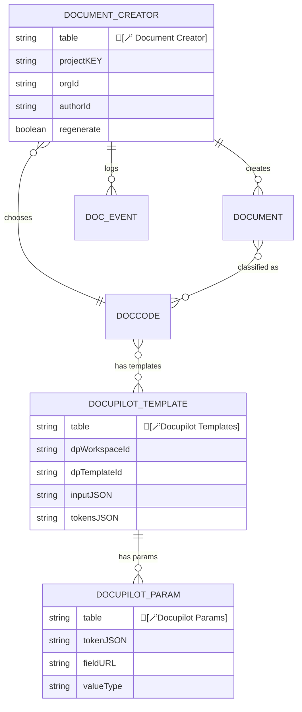
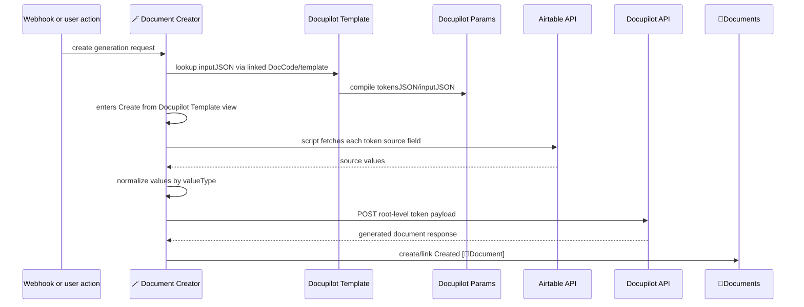
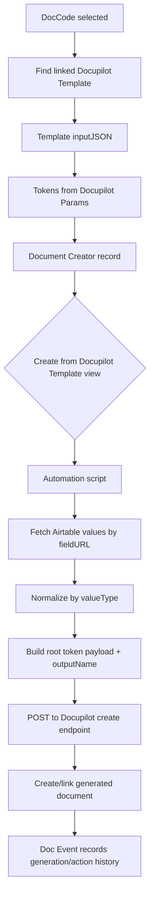

# Docupilot Templates, Params, and Generation

Source: `C:\Users\bwyatt\Downloads\🔷Tables-docs.csv`, exported from `[D] ARCHR Project Documents`.

This document explains how Docupilot templates, token params, webhook/document creator records, and automation scripts compose the JSON sent to Docupilot. It pairs with [document-classification-doc-types.md](document-classification-doc-types.md) and [document-search-token-matching.md](document-search-token-matching.md).

## Summary

The Docupilot system is a dynamic template generation pipeline:

1. A user or webhook creates a `🔷[🪄 Document Creator]` record.
2. The creator record links to a `DocCode`.
3. The DocCode links to one or more `🔷[🪄Docupilot Templates]`.
4. The template links to `🔷[🪄Docupilot Params]`.
5. Each param supplies a Docupilot token name, an Airtable field URL, and a value type.
6. An Airtable automation script reads the config JSON, fetches values from Airtable by field URL, normalizes each value, builds a root-level Docupilot payload, and posts to the Docupilot create endpoint.
7. The automation creates/links the resulting document record.

## Core Tables

| Table | Table ID | Main role |
|---|---:|---|
| `🔷[🪄 Document Creator]` | `tblsr4IynmGisGRkL` | Trigger/control record for generation. Has view `Create from Docupilot Template`. |
| `🔷[🪄Docupilot Templates]` | `tbliYCjONuEGEcTDV` | Template registry. Stores Docupilot IDs, DOCX attachments, token config JSON, and linked params. |
| `🔷[🪄Docupilot Params]` | `tblwnPjDiuvj1OhXT` | Token parameter registry. Maps Docupilot token names to Airtable field URLs and value types. |
| `🔷[DocCode]` | `tblXLYYDEbby2D9nb` | Links generated document types to Docupilot templates and document workflow. |
| `🔷[Doc] Events` | `tbl1AyB7Bhq4Ni90Y` | Event/audit log for document generation and later actions. |
| `🔷[📎Documents]` | `tbl6d5H0YHWQndDRM` | Created/merged document record target. |

## Generation Model



## Template Records

`🔷[🪄Docupilot Templates]` stores the template-level config:

| Field | Role |
|---|---|
| `Name` | Template label. |
| `(ENG) template_DOCX`, `(SPA) template_DOCX` | Source template files. |
| `Document Example` | Example output/reference. |
| `dpWorkspaceId`, `dpTemplateId` | Docupilot template identifiers. |
| `Document Builder Params` | Linked param records. |
| `tokensJSON` | Rollup/compiled token array. |
| `inputJSON` | Compiled config passed into the automation script. |
| `[DocCode]`, `[DocTypes]` | Classification links. |

The automation script supports either:

- `dpEndpointUrl`, or
- legacy pair `dpWorkspaceId` + `dpTemplateId`

The CSV script comments show the expected config shape:

```json
{
  "dpEndpointUrl": "https://api.docupilot.app/documents/create/{workspace}/{template}/",
  "downloadMode": "true",
  "outputNameTemplate": "Document - {{docHomeFullName}}",
  "tokens": [
    {
      "tokenName": "{{docHomeFullName}}",
      "valueFieldUrl": "https://airtable.com/appXXX/tblXXX/viwXXX/fldXXX",
      "valueType": "string"
    }
  ]
}
```

## Param Records

`🔷[🪄Docupilot Params]` stores each token mapping:

| Field | Role |
|---|---|
| `Name`, `Label` | Human label for the parameter. |
| `[🪄Docupilot Templates]` | Template using the param. |
| `fieldURL` | Airtable field URL. The script parses `app...`, `tbl...`, optional `viw...`, and `fld...`. |
| `fieldToLookup` | Human-facing/source field reference. |
| `valueType` | Normalization type. Supported by script: `imageUrl`, `string`, `num`, `currency`, `int`, `richText`. |
| `tokenJSON` | JSON object for one token. |
| `arrayElements`, `ListItems`, `From field: ListItems 2` | Support for list/array-style document content. |
| `findDoor`, `findLocation`, `findTrim` | Domain-specific helpers for scope/repair parsing. |
| `Calculation 2`, `Note` | Formula/debug/supporting text. |

## Document Creator Trigger

`🔷[🪄 Document Creator]` has views `reveiw`, `Intake Forms`, and `Create from Docupilot Template`. Its automation trigger is:

- `Create from Docupilot Template` -> `🟪Create from Docupilot Template`

Important creator fields:

| Field | Role |
|---|---|
| `[[DocCode]]` | Which document to generate. |
| `[DocType] (from [[DocCode]])` | Category inherited from the DocCode. |
| `inputJSON (from [🪄Docupilot Templates]) (from [[DocCode]])` | Config JSON consumed by the script. |
| `Create from Docupilot Template` | Trigger/formula/button-like field that places the record into the automation view. |
| `Created [📎Document]` | Output document link. |
| `[Doc] Events` | Audit/action log. |
| `authorId`, `orgId`, `projectKEY`, `source`, `signature` | Generation context and source inputs. |
| `regenerate` | Allows repeat generation. |

The CSV also shows `webhook CreateDocument` creating `Document Creator` records. That means a webhook can enter the same pipeline by writing a creator row with the needed context.

## Automation Sequence



## Script Method

The automation script in the CSV is titled `Airtable Dynamic Token Loader → Docupilot`. Its important behavior:

### Inputs

Required automation inputs:

- `airtablePAT`
- `triggerRecordId`
- `configJson`

Optional:

- `defaultDownloadMode`, defaulting to `"true"`

### Config Parsing

The script accepts flexible Airtable shapes:

- Raw JSON string
- Double-encoded JSON
- Airtable lookup array with `{ value: "..." }`
- Wrapper objects such as `input`, `config`, `docConfig`, `docConfigJson`, `payload`, `payloadJson`, `data`, or `fields`
- Code-fenced JSON
- Strings prefixed with `input:`

It unwraps until it finds a valid config with:

- `dpEndpointUrl` and `tokens`, or
- `dpWorkspaceId`, `dpTemplateId`, and `tokens`

### Token Loading

For each token:

1. Clean `tokenName` by removing `{{` and `}}`.
2. Parse `valueFieldUrl` into Airtable base ID, table ID, optional view ID, and field ID.
3. Use `triggerRecordId` as the source record ID unless the token provides a `recordId` override.
4. Fetch the source record through the Airtable API.
5. Read the configured source field.
6. Normalize the value according to `valueType`.
7. Add the normalized value to the payload under the clean token key.

Supported `valueType` values:

| valueType | Output behavior |
|---|---|
| `imageUrl` | First attachment URL, preferring image attachments. |
| `string` | Plain string coercion. |
| `num` | Number formatting. |
| `currency` | Currency formatting. |
| `int` | Integer formatting. |
| `richText` | Multi-value/attachment-aware text formatting. |

### Payload Composition

The script builds a root-level Docupilot payload:

```json
{
  "docHomeFullName": "Jane Doe",
  "docZeroSignedDate": "2026-06-12",
  "docZeroSignature": "https://v5.airtableusercontent.com/...",
  "outputName": "Document - Jane Doe"
}
```

Important: the payload is not nested under `data`. Docupilot classic create endpoint expects token data at the root.

### Output Name

If `outputNameTemplate` exists, the script replaces `{{tokenName}}` placeholders with the generated data values. If not, it falls back to:

```text
Docupilot_{triggerRecordId}
```

### Docupilot Request

The script:

1. Builds the endpoint from `dpEndpointUrl`.
2. Adds `download={downloadMode}` if not already present.
3. Sends `POST` with `Content-Type: application/json` and `Accept: application/json`.
4. Sets `Origin` and `Referer` to the Docupilot endpoint origin/base URL for Docupilot/Django CSRF strict referer checks.
5. Parses the response as JSON if possible.
6. Writes debug outputs including `docConfig`, `docupilotUrl`, `docupilotPayload`, `data`, `debug`, and `docupilotResult`.

## Scope and List Item Generation

The CSV also includes document-building support for subcontractor scopes:

- `🔷Subcontractor Documents` view `createSubQuoteLineItems` triggers `🟪🟢Create Subcontractor Quote Line Items`.
- `🔷[DocBuilder] List Items` stores generated line items with `Task`, `area`, `Details`, `Value`, `Checked`, and `Rejected`.
- The script parses CSV-like lines in the shape `Task, Area, Description, $1,234`.
- It outputs a `Scope` object and `ScopeJson`:

```json
{
  "subcontractor": "rec...",
  "archrApp": "rec...",
  "submission": "rec...",
  "tasks": [
    {
      "task": "Repair step",
      "area": "Kitchen",
      "desc": "Description",
      "amount": 1234
    }
  ]
}
```

This scope/list-item path appears to support subcontractor quotes, scopes of work, and generated contract-style documents.

## Generation Flow



## Debug Checklist

1. Start with the `🔷[🪄 Document Creator]` record.
2. Confirm `[[DocCode]]` is linked.
3. Confirm the DocCode links to the intended `🔷[🪄Docupilot Templates]`.
4. Inspect template `inputJSON` and `tokensJSON`.
5. For each param, confirm `fieldURL` contains valid `app`, `tbl`, and `fld` IDs.
6. Confirm `valueType` is one of `imageUrl`, `string`, `num`, `currency`, `int`, or `richText`.
7. Confirm `triggerRecordId` is the right source record for the configured field URLs, or that token-level `recordId` overrides are present.
8. Check automation outputs: `docupilotPayloadBeforeFetch`, `debugBeforeFetch`, `docupilotResponseStatus`, and `docupilotResponseText`.
9. Confirm `Created [📎Document]` is linked after a successful response.

## Open Questions

- Whether generated files are always downloaded back into Airtable or sometimes left as Docupilot URLs.
- Exact shape of `inputJSON` formulas in the template table.
- Whether multilingual templates select `(ENG) template_DOCX` versus `(SPA) template_DOCX` by DocCode, person preference, or webhook input.
- Whether `regenerate` creates a new document every time or replaces the `Created [📎Document]` link.
